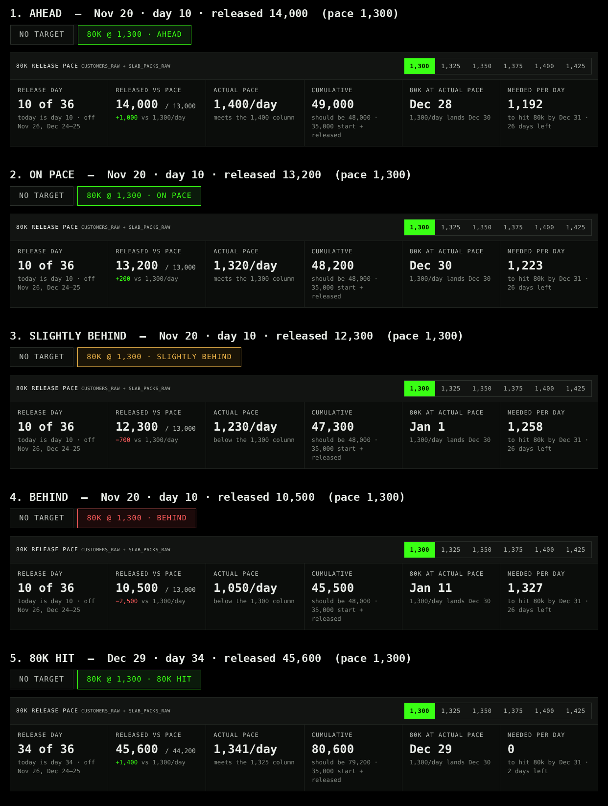

# Goal Pace

Pace tracker built on the Target Goals report (Metabase question 30328). Pick any date range, tick metrics to add them together, type a goal, see if you're on pace.

## Deploy
1. Upload this folder to a new Vercel project (framework: Other).
2. Env vars:
   - `METABASE_HOST` = https://arena-club.metabaseapp.com
   - `METABASE_API_KEY` = your Metabase API key
   - `METABASE_QUESTION_ID` = optional, defaults to 30328
   - `METABASE_DATABASE_ID` = optional, defaults to 397 (only used by the fallback)
3. Deploy.

## Data source
`/api/report?start=YYYY-MM-DD&end=YYYY-MM-DD` runs question 30328 with its `start_date` and `end_date` variables, so edits to the Metabase card (targets, filters) flow straight into the app. If the card can't be run, it falls back to the copy of the SQL in `api/_sql.js` and the header shows "embedded sql" instead of "question 30328".

Only the five intake metrics are shown; pipeline rows from the card are ignored.

`/?demo=1` runs on simulated data.

## 80K release pace
The `80K @ pace · status` pill next to the status pill opens the release pace page (`/#release`). It tracks the Nov 9 – Dec 31 schedule: 35,000 start, 80,000 goal, 36 release days (weekdays, off Nov 26, Dec 24, Dec 25), counting `customers_raw` + `slab_packs_raw`.

The page has a daily pace picker (1,300–1,425), metric toggles, the cumulative total vs 80k, a cumulative-vs-pace chart, and a day-by-day table: each day's customers_raw, slab_packs_raw, released, vs pace, cumulative, pace target (✓ on the day the picked pace hits 80k), gap, and Hit / Missed. Weekend days with releases are listed but don't count as release days. Today counts toward the target as it's released (up to one day of pace), so a mid-day check doesn't read as behind.

Data comes from `/api/daily?start=&end=`, which runs per-day counts through the same order/card filters as the report (shared CTEs in `api/_sql.js`). It's independent of the date range picked on the main page. Schedule constants are in `RP` in `public/index.html`.

